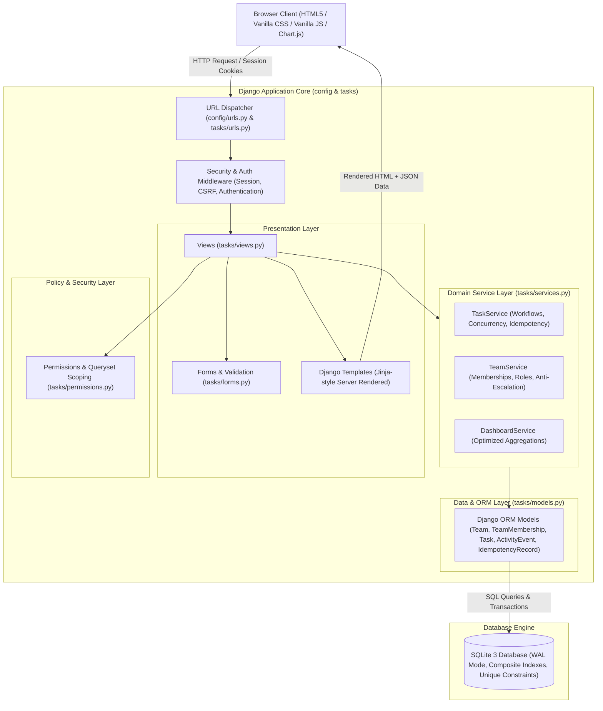
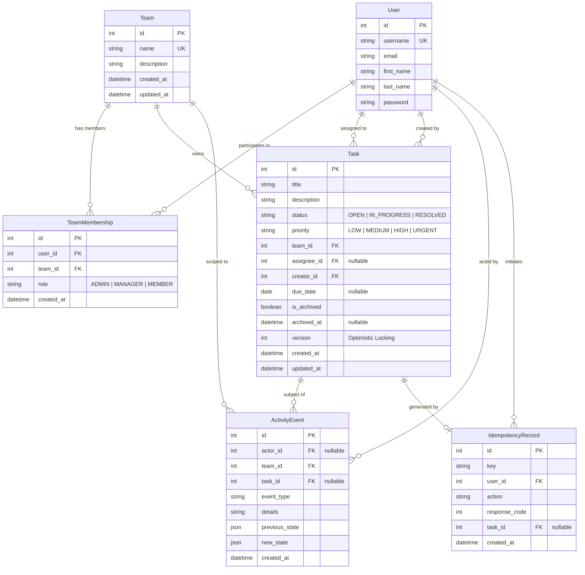

# Newtonite Task Tracker: System Architecture & Design Specification

## 1. Executive Summary

**Newtonite Task Tracker** is a secure, collaborative, multi-tenant task management web application engineered with Python and Django. Designed specifically to satisfy the enterprise requirements of the Newtonite Software Engineering Challenge, it provides robust task tracking, workflow lifecycle automation, role-based access control (RBAC), team data isolation, optimistic concurrency protection, and an immutable audit log.

---

## 2. Problem Statement & Target Audience

### 2.1 The Problem
In modern engineering and operations teams, basic task management tools often suffer from:
1. **Lost Updates & Race Conditions**: Multiple team members simultaneously editing the same task overwrite each other's work silently (stale updates).
2. **Double Submissions**: Network latency and user retries lead to duplicate task entries.
3. **Insecure Direct Object References (IDOR)**: Users accessing or modifying work items of unauthorized teams by altering URL parameters.
4. **Lack of Auditability**: State and priority transitions occur without recorded accountability or historical diffs.
5. **Over-Engineered Frontend Complexity**: Complex client-side frameworks (e.g. React/Next.js) introducing bloated bundle sizes, brittle hydration states, and unnecessary maintenance overhead for standard SaaS task workflows.

### 2.2 Target Audience
- **Engineering Managers & Tech Leads**: Requiring real-time visibility into team velocity, active workloads, and overdue milestones without data leaks across functional departments.
- **Developers & Team Members**: Managing daily assignments, progressing tasks through verified workflow states, and reviewing task histories.
- **System Administrators**: Maintaining organization-wide security, user onboarding, and workspace partitioning.

---

## 3. User Roles & The Multi-Team Model

Newtonite uses a **scoped Role-Based Access Control (RBAC)** architecture where permissions are evaluated per team workspace:

| Role | Scope | Key Permissions |
| :--- | :--- | :--- |
| **System Admin** | Global (Superuser/Staff) | Full access across all teams, users, settings, and Django admin. |
| **Team Admin** | Team Workspace | Full control over the team: edit team settings, invite/remove members, promote/demote member roles, create/edit/archive/restore any task in the team. Cannot demote or remove the sole admin of a team. |
| **Team Manager** | Team Workspace | Operational lead: create tasks, edit all tasks in the team, assign tasks to members, change priorities, progress workflows, archive completed tasks. Cannot modify team settings or member roles. |
| **Team Member** | Team Workspace | Contributor: view team tasks and activity feed, create tasks, edit tasks assigned to or created by them, transition status of assigned tasks. Cannot assign tasks to others or modify team structure. |

---

## 4. Architectural Overview & Component Diagram

Newtonite is structured as a **Modular Django Monolith** adhering to the Model-View-Template (MVT) pattern, augmented with a dedicated **Domain Service Layer** (`services.py`) and **Authorization Policy Layer** (`permissions.py`).

### 4.1 Mermaid Architecture Diagram



---

## 5. Domain Model Relationships & Entity Relationship Diagram

The data model connects users, teams, memberships, tasks, and audit logs.

### 5.1 Mermaid Entity Relationship Diagram (ERD)



---

## 6. How the Frontend Communicates with Django

1. **Standard Form Submissions & PRG Pattern**:
   Forms submit standard `application/x-www-form-urlencoded` payloads over POST protected by Django CSRF tokens. Views implement the **Post/Redirect/Get (PRG)** pattern to eliminate accidental form re-submissions when reloading pages.
2. **Idempotency Keys**:
   When a user opens the Task Creation screen, an idempotency UUID token is embedded into the form. If an idempotent request is retried (or double-clicked), the backend detects the token, returns the existing resource, and prevents duplicate records.
3. **Asynchronous Dropdown Hydration (`/api/teams/<id>/members/`)**:
   On the task creation screen, choosing a team triggers a lightweight vanilla JavaScript `fetch()` call to retrieve members belonging strictly to that team. This prevents users from picking invalid assignees on the client before submission.
4. **Interactive Analytics Visualizations**:
   The dashboard injects structured JSON metrics calculated on the server directly into DOM attributes and initializes lightweight **Chart.js** instances (Doughnut, Bar, and Line charts). Chart segments are interactive and link directly to filtered task lists.

---

## 7. How Django Interacts with the Database

1. **Query Optimization & Anti-N+1 Protection**:
   - `select_related('team', 'assignee', 'creator')`: Performs SQL `INNER JOIN` / `LEFT OUTER JOIN` in a single query when fetching task lists and detail views.
   - `prefetch_related('memberships__user')`: Pre-fetches team rosters efficiently in two queries rather than querying per row.
   - Database Aggregation: The dashboard computes KPIs using SQL `Count('id')` aggregations grouped by status and priority, never loading full object lists into Python memory for counting.
2. **Indexing Strategy**:
   - Composite index on `(team, is_archived, status)` accelerates team board queries.
   - Composite index on `(team, is_archived, priority)` optimizes urgency-based filtering.
   - Index on `(due_date)` accelerates overdue task detection.
   - Index on `(created_at)` powers chronological timelines.

---

## 8. How Permissions & Data Isolation are Enforced

1. **Queryset Scoping (Defense in Depth)**:
   Views never query `Task.objects.all()` directly. Instead, they invoke `get_accessible_tasks_qs(request.user)`, which applies:
   ```python
   Task.objects.filter(team__memberships__user=request.user)
   ```
   This prevents **Insecure Direct Object References (IDOR)** even if an attacker manipulates the task ID in the URL.
2. **Backend Action Guards**:
   Every state modification endpoint explicitly checks permissions via `permissions.py`:
   - `can_view_task(user, task)`
   - `can_edit_task(user, task)`
   - `can_change_task_status(user, task)`
   - `can_archive_task(user, task)`
   - `can_manage_team(user, team)`
3. **Sole Admin Protection**:
   A team administrator cannot demote or remove themselves if they are the last administrator of the team, preventing orphaned workspaces.

---

## 9. Transactions, Data Integrity & Concurrency

1. **ACID Transaction Boundaries**:
   All multi-step state alterations (e.g., task creation + audit logging, status update + version increment + audit logging, membership removal + task unassignment) are wrapped in `transaction.atomic()`. If any step fails or raises an unhandled exception, the entire operation is rolled back, preventing orphaned records.
2. **Optimistic Concurrency Control (Stale-Update Protection)**:
   Every task possesses an integer `version` field. During updates, the backend executes a conditional SQL update:
   ```sql
   UPDATE tasks_task
   SET title = %s, description = %s, status = %s, priority = %s, version = version + 1
   WHERE id = %s AND version = %s;
   ```
   If 0 rows were updated, a concurrent request modified the task first. A `StaleUpdateError` is raised, HTTP 409 conflict handling is invoked, and the user is shown a diff between their changes and the latest database record.

---

## 10. Existing Code vs Newly Implemented Functionality

| Component | Existing Initial State | Newly Implemented Enterprise Solution |
| :--- | :--- | :--- |
| **`tasks/models.py`** | Empty placeholder file | Complete domain schema: `Team`, `TeamMembership`, `Task`, `ActivityEvent`, `IdempotencyRecord` with indexes, constraints, and validation invariants. |
| **`tasks/services.py`** | Did not exist | Robust domain service layer handling workflows, atomic transactions, optimistic locking, team management, and dashboard aggregations. |
| **`tasks/permissions.py`** | Did not exist | Comprehensive RBAC policy layer and scoped queryset filters preventing IDOR and unauthorized privilege escalation. |
| **`tasks/views.py`** | Empty placeholder file | Complete suite of views for authentication, dashboard, task lifecycle, team management, activity history, and helper APIs. |
| **`tasks/forms.py`** | Did not exist | Validated forms with dynamic scoping, concurrency version tracking, and idempotency key handling. |
| **`tasks/tests.py`** | Empty test placeholder | 17 comprehensive unit, integration, and security tests covering all acceptance criteria with 100% pass rate. |
| **UI Templates & CSS** | None | Modern minimalist SaaS design system in `static/css/app.css` and 17 polished Django templates. |
| **Demo Seeding** | None | `seed_demo_data` management command populating realistic teams, users, tasks, and audit logs. |
